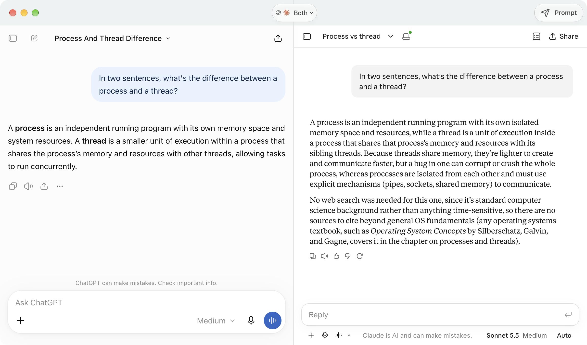

# Duet

Duet is a native macOS app for ChatGPT and Claude. Each service runs in its own web interface, just as it does in a browser, and Duet adds what a browser tab can't: switching between them with one keystroke, a side-by-side view, a prompt drawer that sends the same text to both, and a global shortcut that starts a new conversation from any app.

[See the single-provider view](Screenshots/single-view.png).

Duet is an independent app. It isn't affiliated with or endorsed by OpenAI or Anthropic, and you use it at your own risk.

## Install

Duet requires macOS 27 or later.

1. Download `Duet.zip` from the [latest release](https://github.com/cpoteet/Duet/releases/latest) and double-click it to extract the app.
2. Drag `Duet.app` to your Applications folder.
3. Open Duet from Applications. macOS may ask you to confirm the first time you open it.

## Getting started

When Duet opens, choose ChatGPT, Claude, or Both. Then sign in to each provider in its own pane, the same way you would on the website, including passkeys, two-factor authentication, and any verification steps. Duet keeps your sessions between launches, so you normally sign in only once.

The first time you use a feature that needs your microphone (dictation or voice chat) or your location, macOS asks for permission. Camera requests also ask you to confirm. Only ChatGPT and Claude pages can use these, never sign-in pages or other sites.

## Switching providers and split view

Use the picker in the toolbar, or press Command-1, Command-2, or Command-3, to show ChatGPT, Claude, or Both. In Both, the two providers sit side by side. Drag the divider to resize them, or choose View → Equal Widths to even them out.

To start a new conversation, choose File → New Conversation or press Command-N. In split view, both panes start new conversations.

By default Duet keeps only the visible provider loaded, which saves memory. If you switch often, turn on Keep both providers loaded in Settings to make switching faster.

## Sending one prompt to both

The prompt drawer is a native text box at the bottom of the workspace. Open it with the Prompt button in the toolbar or Command-Shift-P. It also opens on its own whenever you enter split view.

- With one provider showing, Send to ChatGPT or Send to Claude (Command-Return) sends to that provider, and Send to Both (Command-Option-Return) switches to split view and sends to both.
- In split view, Send to Both is the only option (Command-Return).

Duet types your prompt into each provider's own message box and presses its send button, and each provider reports its own status. After every provider confirms, the drawer clears and closes. If a send fails, or you edit the text while it's sending, Duet keeps your draft. It never resends on its own, and it won't overwrite a message you already started typing in a provider's box.

The drawer handles text only. For attachments and provider-specific tools, use the provider's own composer.

## Quick Prompt

Press Control-Option-Space in any app to open Quick Prompt, or choose Tools → Quick Prompt while Duet is in front. Type a prompt and send it to ChatGPT, Claude, or Both. Each provider you pick gets a brand-new conversation, and Duet brings its window forward so you can keep going. That includes reopening the window if you closed it or bringing it back if it was minimized.

## Notifications

Duet can tell you when a response finishes while you're in another app or the Duet window is hidden or minimized. Turn this off with Notify when responses finish in Settings. Notifications the ChatGPT and Claude websites send themselves also appear as macOS notifications. Click one to return to Duet.

## Files, printing, and links

Attach files with the standard macOS file picker, or drag files from Finder into ChatGPT or Claude. When a provider gives you a file to download, Duet asks where to save it. Printing from a provider page opens the macOS print panel.

Links to other websites, and any pop-up windows a provider opens, open in your default browser.

## Settings

Open Duet → Settings to choose:

- **When Duet opens:** Ask Every Time (the chooser), ChatGPT, Claude, Both, or Last Used, which reopens whichever layout you used most recently. Duet also remembers your window size.
- **Keep both providers loaded:** faster switching, at the cost of more memory.
- **Notify when responses finish:** on by default.

## Privacy and your data

You sign in directly with OpenAI and Anthropic, and Duet never sees, stores, or sends your credentials. Your conversations, history, attachments, and provider features stay on the providers' websites. Duet doesn't read, copy, or combine responses.

To sign out of one provider and clear its saved website data, choose Session → Reset ChatGPT Website Data or Session → Reset Claude Website Data. Resetting one leaves the other signed in.

## Updates

Once per launch, Duet checks GitHub for a newer public release and shows a banner if there is one. Dismiss the banner to hide it until the next release comes out. Duet never downloads or installs updates by itself. Download the new version from the release page and replace the old app.

## License

Duet is available under the Duet License. You may use it for any purpose, including paid work, and you may change and build it for yourself or share your build within your own organization. You may fork the repository on GitHub as GitHub's Terms of Service allow. You may not sell Duet or a derivative, charge to host, install, or support it, or distribute it in any other way. Your use of ChatGPT and Claude stays subject to their providers' terms. The software comes without warranty.

Read the full [LICENSE.md](LICENSE.md). A copy is also included in every `Duet.zip`.
